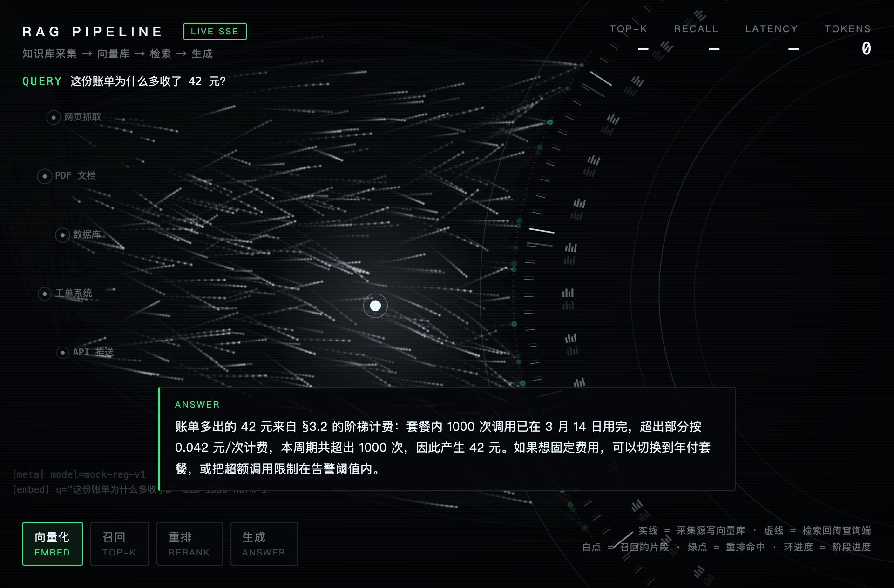
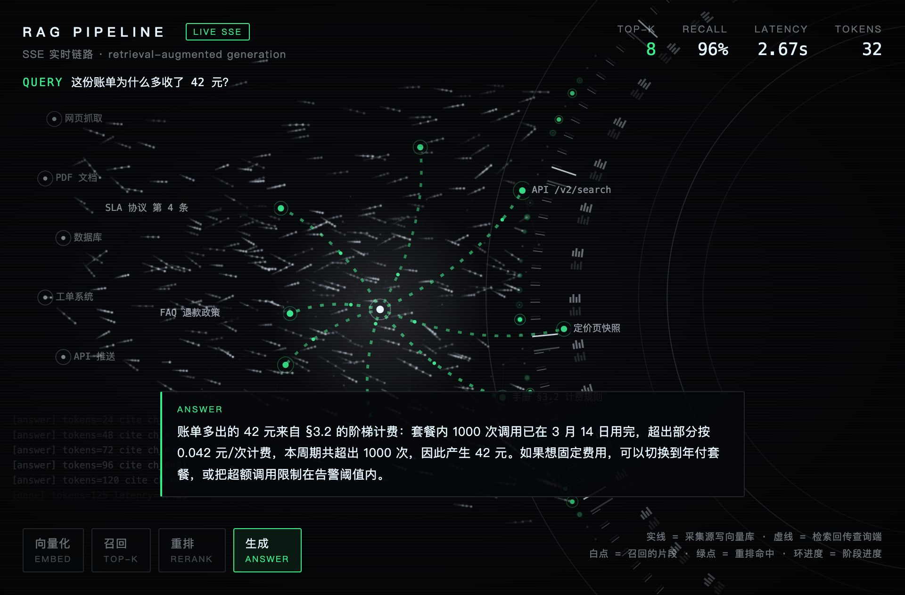
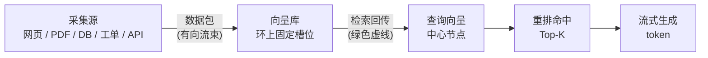

# RAG HUD

> 把「数据采集 → 向量入库 → 检索 → 生成」这条黑箱链路，变成一块能看的数据流仪表盘。

零依赖、Canvas 2D 实现的 RAG 过程可视化组件。传入一个 `<canvas>` 和一组事件，就能把知识库的写入与召回过程渲染成有方向的数据流。



## 特性

- **有向数据流**：每个数据包从采集源出发，沿弧线飞向向量库环上的固定槽位，到达时闪烁表示写入完成——不是无意义的随机粒子。
- **槽位稳定映射**：`chunk id` 经 FNV-1a 哈希映射到环上固定角度，同一个片段永远落在同一个存储位置。
- **检索反向可视化**：查询阶段数据流反向回传，命中片段由白转绿，虚线沿链路流动。
- **两层画布**：底层用「只压暗不清屏」制造运动拖尾，上层保持线条与文字锐利，兼顾流体感与可读性。
- **一个 canvas 跑起来**：流动层由库内部创建离屏画布合成，接入方只需提供一个有尺寸的 canvas。
- **SSE 直连**：内置 `attachSSE()`，按约定的事件协议即可对接任何后端；连不上时可自行降级为本地模拟。
- **会话录制与回放**：每轮事件自动录制，导出为 JSON 后可离线按时间轴重放、拖动进度条，把可视化变成排查工具。
- **性能友好**：流动层 1x 分辨率、DPR 上限 2、ResizeObserver 自适应，`prefers-reduced-motion` 自动降速。



## 工作原理



- **实线流**：采集源 → 向量库，速率随阶段变化（向量化阶段最快，检索阶段降到约 0.55x，但永不停止）。
- **虚线流**：向量库 → 查询端，`lineDashOffset` 反向滚动，粒子点由片段流向中心。
- **环**：外圈刻度是向量库容量，绿色弧是当前阶段进度，环上的点是存储槽位（已写入稍亮、命中为实心绿）。

## 快速开始

```bash
node mock-sse-server.js          # 启动本地演示后端（零依赖）
open http://127.0.0.1:8787/rag-hud-demo.html
```

接入自己的项目：

```html
<canvas id="hud" style="width:100%;height:100%"></canvas>
<script src="hud.js"></script>
<script>
  const hud = RagHud.create(document.querySelector('#hud'), {
    onStage(name, progress) {},
    onStats({ stage, topk, recall, latency, tokens, candidates, hits }) {},
    onAnswer(text, done) {},
    onLog(text) {}
  });

  hud.attachSSE('/api/rag/stream', { query: '这份账单为什么多收了 42 元？' });
</script>
```

也可以完全手动驱动，不依赖 SSE：

```js
hud.setStage('retrieve', 0.3);
hud.setCandidates([{ id: 'ch_0481', label: '手册 §3.2 计费规则', score: 0.93 }]);
hud.setHits(hits, { recall: 0.96, latency: 0.42 });
hud.token('逐');  hud.token('字');
hud.done({ tokens: 128, latency: 2.1 });
```

TypeScript 项目直接使用 `hud.d.ts`，`create()`、事件回调与全部方法的类型均已声明：

```ts
import { create, type HudOptions } from 'rag-hud';

const hud = create(canvas, { slotCount: 64 } satisfies HudOptions);
```

## SSE 事件协议

服务端返回 `text/event-stream`，事件格式为 `event: <name>\ndata: <json>\n\n`。

| 事件 | 数据 | 视觉反应 |
| --- | --- | --- |
| `meta` | `{ query, model }` | 日志记录模型信息 |
| `stage` | `{ name: embed \| retrieve \| rerank \| generate, progress? }` | 阶段条、环进度 |
| `candidates` | `{ chunks: [{ id, label, score }] }` | 生成片段节点与关系网，槽位被占用 |
| `hits` | `{ chunks: [...], recall?, latency? }` | 命中变绿、其余压暗 |
| `token` | `{ text }` | 回答逐字输出 |
| `log` | `{ text }` | 左侧实时日志 |
| `done` | `{ tokens?, latency? }` | 收尾 |

后端示例（Node）：

```js
res.writeHead(200, {
  'Content-Type': 'text/event-stream; charset=utf-8',
  'Cache-Control': 'no-cache, no-transform',
  Connection: 'keep-alive',
  'Access-Control-Allow-Origin': '*'
});
res.write(`event: stage\ndata: ${JSON.stringify({ name: 'retrieve' })}\n\n`);
```

> `EventSource` 只能发起 GET 请求。若检索接口是 POST，建议在前面加一层薄 BFF 转发，或把参数放到 query string。

## 配置项

| 参数 | 默认值 | 说明 |
| --- | --- | --- |
| `sources` | 5 个采集源 | 采集源的数量与坐标（相对画布的比例） |
| `slotCount` | `96` | 向量库槽位数量，决定环上存储位置的疏密 |
| `packetCount` | `300` | 并发在飞的数据包数量，直接影响流束密度 |
| `colors.ink` | `232,246,255` | 主线条色（`r,g,b`） |
| `colors.accent` | `50,240,140` | 命中/高亮色（`r,g,b`） |
| `font` | 系统等宽字体 | 画布内文字字体 |
| `reducedMotion` | 跟随系统 | 强制关闭动效降级 |

## 会话录制与回放

每一轮事件都会被自动录制（`record: false` 可关闭），导出的就是一串纯 JSON，可以直接落盘存档。

```js
const session = hud.exportSession();   // { version, ms, events: [{ t, kind, data }] }

const player = hud.replay(session, { speed: 1, loop: false, onEnd: () => {} });
player.pause();
player.seek(session.ms * 0.6);         // 拖到 60% 处
player.progress();                     // 0~1，可直接绑定进度条
```

录制格式与 SSE 事件一一对应，因此可以把线上某次查询的完整会话存下来，离线复现问题，不需要真实后端在线。

演示页按 **R** 即可回放最近一轮。

> 回放期间建议先关闭 SSE 连接（`handle.close()`），避免实时事件与录制时间线互相干扰。

## 性能

| 项目 | 做法 |
| --- | --- |
| 流动层 | 独立离屏画布，1x 分辨率，`drawImage` 合成 |
| 锐利层 | 主画布，DPR 上限 2（4K/Retina 不会爆填充率） |
| 每帧开销 | 约 300 条短线段 + 300 个 1px 圆点 + 150 刻度 |
| 自适应 | `ResizeObserver` 重排；页面隐藏时 `requestAnimationFrame` 自动暂停 |

## 目录结构

```
.
├── hud.js                 # 可视化库（IIFE + CommonJS）
├── hud.d.ts               # TypeScript 类型声明
├── rag-hud-demo.html      # 演示页：HTML 面板 + SSE 接线
├── mock-sse-server.js     # 本地 mock RAG 后端（零依赖）
└── docs/images/           # 截图
```

## Roadmap

- [ ] ECharts / D3 场景下的嵌入示例
- [ ] WebGL 渲染路径，支持上万条流束
- [x] 时间轴回放：把一次检索会话导出为可回放数据
- [ ] 主题预设（除默认黑白 + 绿之外）

## License

[MIT](./LICENSE).
